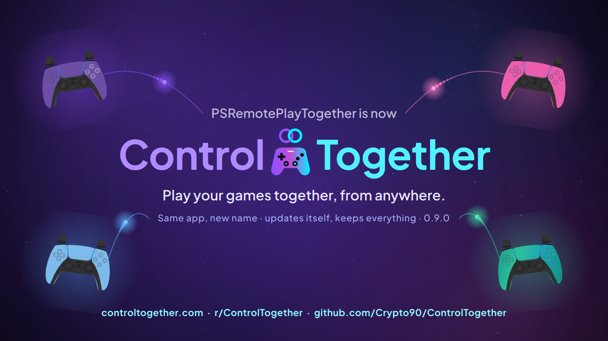

# PSRemotePlayTogether is now ControlTogether

**Same app, same people behind it, a new name since version 0.9.0.**

## Where everything is now

- **Source, releases, issues:** [github.com/Crypto90/ControlTogether](https://github.com/Crypto90/ControlTogether)
- **Website and downloads:** [controltogether.com](https://controltogether.com/)
- **Community:** [r/ControlTogether](https://www.reddit.com/r/ControlTogether/)
- **Joining from a browser:** [play.controltogether.com](https://play.controltogether.com/) (the page stays at play.gamernova.net too)

## Already have the app?

Nothing to do. It updates itself to ControlTogether and keeps your settings, friends, invites, looks, controller skins, supporter key and game computers. Links you shared before keep working.

## Why this repository is still here

Apps from before the rename (0.5.2 to 0.8.3) and game computers look for their update under this old name. Its releases carry the files under their old names, the newest is **0.9.1**: those apps install it and from then on follow [ControlTogether](https://github.com/Crypto90/ControlTogether). Please open issues and pull requests there.
